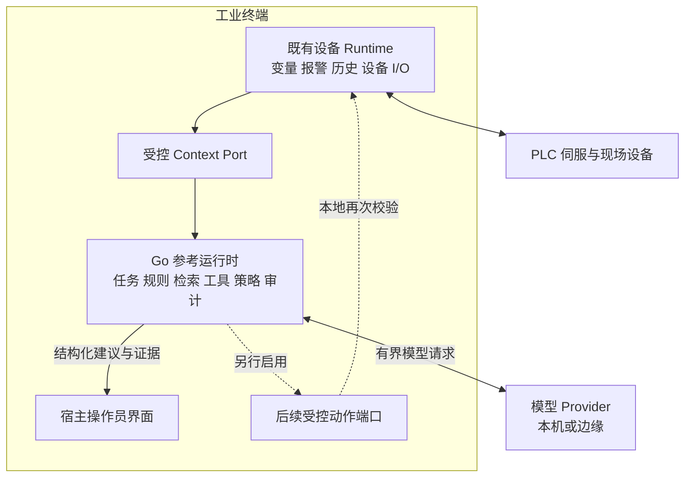

# RFC 0014：有限资源设备的 Go 运行时与可移植治理契约

状态：**提议，等待维护者评审；尚未实现或通过设备认证**

## 摘要

建议 Axrail 增加面向 ARM64 Linux 工业终端、HMI 和边缘网关的受限设备运行配置，并评估提供 Go 参考运行程序。设备能够在有限资源下执行上下文采集、规则、有限 Agent 循环、权限校验、任务恢复和审计；模型推理可以部署在本机、局域网边缘节点或获准使用的远端服务。

首个交付建议是语言中立的最小契约、跨实现一致性测试，以及一个支持离线规则和模拟设备的 Go 可运行样例。后续再依据实测和维护能力决定是否发布受支持的 Go SDK/daemon。

本 RFC 请求评审技术方向与交付范围。当前受支持的 TypeScript Harness、Node.js 基线、npm 包与发布策略继续按已有文档执行；本文不声明已有 Go 发行版，也不要求立即移植全部 TypeScript 包。

## 1. 使用场景与问题

工业终端通常已经运行图形宿主、设备通信、报警、历史记录及操作员界面。Agent 的资源预算来自这些必要功能运行后的剩余量。集成方可能已有 Go 设备服务，希望通过稳定端口组合 Agent 能力，并在 Agent 或模型异常时保持设备 Runtime 可用。

典型场景是：设备报警后，Agent 读取有限的现场状态和趋势，检索匹配型号/固件的知识，生成附带证据的解释与人工巡检步骤。持续控制、运动闭环、急停和安全联锁仍由设备控制系统承担。

现有 Axrail 已有可借鉴的边界：

- [HarnessRuntime](../../packages/harness/src/runtime.ts) 组合工具、策略、审批、事务及 Adapter，并支持 provider-bound ChangeSet 执行。
- [执行语义](../../docs/execution-semantics.md) 区分只读超时与副作用的 `execution_uncertain`。
- [审计模型](../../docs/audit-model.md) 区分观察性事件与副作用前必须持久化的 checkpoint。
- [RFC 0013](../0013-ai-sdk-provider-convergence/README.md) 将模型供应商协议与工具执行权限分离。

这些治理原则适用于设备场景，但当前 npm 实现需要 Node.js；它不能直接作为 Go 库嵌入已有设备进程。新增 Go 路线的价值是提供部署选择与受限实现，并非预先断言 Node.js 在所有设备上不可用。资源收益必须用同工作负载比较。

## 2. 请求维护者提供的交付物

| 交付物 | 内容 | 完成证明 |
| --- | --- | --- |
| 受限设备配置说明 | 功能子集、能力协商、资源边界、支持矩阵 | 明确支持/不支持项和可重复场景 |
| 语言中立治理契约 | 工具/目标/主体/证据身份、审批绑定、结果与错误语义 | Schema、版本策略及正反测试向量 |
| Go 参考程序 | 有限任务状态机、只读工具、规则、模拟模型/设备、持久化恢复 | 无云密钥可运行的 Linux ARM64 样例 |
| 一致性测试包 | 对 TS 与 Go 执行共同案例，比较语义结果 | 每项标记支持等级；不虚报完整 API 一致 |
| 设备测量报告 | 二进制、依赖、RSS/PSS、CPU、启动、存储与恢复 | 固定版本、负载、板型与原始采集记录 |

建议使用暂定名称“constrained-device profile”和“Go reference runner”。最终包名、仓库位置、CLI、支持等级由维护者决定；本 RFC 中的名称不是已发布接口。

## 3. 三种可行路线

| 路线 | 设备运行内容 | 优点 | 代价与限制 |
| --- | --- | --- | --- |
| A：边缘 TS Harness + 本地 Go 执行端 | Go 的上下文与受控端口，模型/编排在边缘 | 最大限度复用当前 Harness | 网络断开时仅本地规则可用；需要可靠认证与恢复协议 |
| B：独立 Go 受限运行时 | Go 规则、任务、工具治理、审计；推理位置可选 | 编排可本地运行，减少额外语言运行时部署项 | 需要维护跨语言语义与一致性测试 |
| C：设备侧 TS Harness | 当前 Node.js 与受限 Adapter | 复用现有实现最快 | 需实际验证依赖、资源与目标 BSP；不能先假定可行或不可行 |

建议先冻结共同契约，再实现 B 的只读样例，并以 A 作为低资源或集中模型场景的部署选择。C 作为对照测量基线。若维护者当前无力维护 Go 实现，可以先接受契约与测试向量，让集成方实现相同子集。

## 4. 推荐的运行边界



Go 运行时建议从一个独立进程开始，内部按职责分包。Context、Task、Policy、Store 等逻辑模块不必变成多个微服务。集成方以后可按实测决定是否嵌入已有 Go 进程，但必须重新评估故障、内存与升级隔离。

设备 Runtime 保有变量、报警和 I/O 权威；Agent 不新增一条绕过 Runtime 的 PLC 轮询/写入链。对外协议适配器、MCP 或模型供应商 SDK 均不能获得旁路执行权限。

本地优先评估 Unix socket 上的受限请求/事件接口；跨主机使用受认证的加密通道。传输不是可信身份来源：请求内自填的 actor/provider 字段不能授予权限，宿主必须绑定进程或已验证会话身份。

## 5. 最小治理契约

协议应描述行为而非序列化 TypeScript 类、闭包或内部对象。现有字段先建立映射；不能仅因名字相同就宣称兼容。

| 对象 | 最小语义 | 必须拒绝的情况 |
| --- | --- | --- |
| 能力声明 | 稳定能力 ID、版本、输入输出 Schema、effect/risk、provider、支持等级 | 未知版本、伪造只读标记、歧义 provider |
| 调用上下文 | 可信主体、目标、作用域、关联 ID、deadline、版本前提 | 跨主体/目标复用授权，失效作用域 |
| 现场观察 | 值/类型/单位、质量、源/接收时间、序号、启动 epoch | 陈旧或坏质量数据冒充实时事实 |
| 结构化变更 | 参数、目标版本、预条件、不可变摘要 | 审批后修改参数或目标 |
| 审批证据 | 主体、角色、变更摘要、provider/目标、到期时间、策略版本 | 模型自称已获批准；重放或过期审批 |
| 执行结果 | 成功/拒绝/失败/取消/结果不确定、回读证据、重试语义 | 超时直接记为未执行；ACK 直接记为物理完成 |
| 审计记录 | 调用、checkpoint、结果、关联和证据身份 | 审计不可用仍越过必须持久化的副作用边界 |

支持等级可沿用 `exact / compatible / degraded / unsupported` 的表达方式，但应分别声明具体能力。首期缺少 ChangeSet mutation 或人工审批实现时，应报告 `unsupported`，不能给出空实现的成功结果。

### 跨语言一致性要求

- 冻结 JSON 编码、数值精度、时间、null/缺失字段、枚举和未知字段策略；大整数与十进制值不得依赖 JS/Go 的默认转换恰好相同。
- 对需要审批绑定的文档，规定确定性编码/摘要算法，并提供 TS/Go 共同 golden vectors。不能直接对任意语言 map 的 JSON 输出求哈希并假定一致。
- Schema major 不兼容或必需能力缺失时拒绝执行；可选能力缺失时显式降级。
- 共同测试验证协议语义，不承诺跨语言内部数据结构、二进制格式或全部 npm API 的一致性。

## 6. Go 参考程序的首期范围

建议提供以下包级边界，具体目录由实现阶段确定：

```text
runner       生命周期、健康、有限队列与资源配置
task         有界状态机、截止时间与恢复
capability   编译期工具注册、Schema 与身份校验
policy       确定性授权，默认拒绝
context      受限快照、事件、质量与新鲜度
model        小接口与供应商适配；模拟模型默认可用
store        Run、checkpoint、建议与审计
adapter      宿主业务端口与模拟器
conformance  可移植测试向量与结果报告
```

首个样例允许读取上下文、检索故障知识和保存建议/人工任务；不提供设备写入、任意 Shell、任意网络工具或动态下载代码。声明式 Skill 只引用已注册能力及资源预算。可执行扩展通过受审版本交付，第三方脚本/WASM 留待独立设计。

Go 模型边界只返回文本或结构化工具请求；工具始终由本地治理层执行。适配器传播 deadline/取消、限制请求和响应字节、最大步骤、并发与重试。若由边缘 TS 服务复用 AI SDK，Go 端接收结果仍需本地校验；边缘服务不能注入有执行权的回调。

## 7. 资源目标与测量方法

以下数字仅是首轮实验目标，**不是已有 benchmark 或最低硬件要求**。设备需先测既有 Runtime、图形栈和系统峰值，再预留恢复空间。Go 与 TS 方案使用相同 fixture、相同模型位置和功能子集比较。

| 指标 | 初始目标/方法 |
| --- | --- |
| Agent 空闲 RSS | 争取 ≤64 MiB；记录 PSS、Go heap 与常驻知识规模 |
| Agent 峰值 RSS | 争取 ≤128 MiB；覆盖 TLS、最大上下文、突发事件与持久化 |
| 模型并发 | 默认 1；模型权重和推理进程单独计量并纳入整机报告 |
| Run 上限 | 初始最多 4 个工具步骤、总时限 30 秒；均可配置且有硬上限 |
| 输入/输出 | 初始上下文 64 KiB、模型响应 128 KiB；流式读取阶段限制 |
| 队列 | 事件数和字节数双上限；普通遥测合并，事件缺口可观察 |
| 存储 | 固定保留策略、配额、WAL/索引预留与磁盘满行为 |
| 共存影响 | 测 Agent 开/关时宿主交互和采样 P95；初始增幅目标 ≤10%，并冻结绝对阈值 |
| 长稳 | 同工况连续 72h；观察内存、队列、存储增长和恢复 |

`GOMEMLIMIT` 是软限制，不能代替 RSS/cgroup 限制；`GOMAXPROCS` 也不是进程 CPU 配额。应同时测整个进程树、native/mmap 分配、OOM 行为与宿主服务影响。参见 [Go GC Guide](https://go.dev/doc/gc-guide)。

基准报告应记录板型、RAM、内核/libc、工具链、固件/程序摘要、事件速率、上下文大小、知识大小、模型位置及采集方法。不要求设备具备本机 LLM/NPU；推理吞吐不能用芯片 TOPS 数字替代。

## 8. 失败、持久化与副作用

### 只读任务与事件

事件至少一次交付，通过启动 epoch、事件 ID 与 Skill 版本去重。完成结果持久化后再推进 checkpoint。消费者落后超过保留窗口时报告 gap，重新获取快照；不能静默丢失后宣称诊断证据完整。

规则与故障码查询在模型离线时仍可用。工程、设备绑定或知识版本变化使旧任务失效或要求重采样。Agent 重启后，只读任务可按策略重建；过期建议不自动补发。

### 后续动作

动作能力单独启用，并保持以下不变量：

1. 每个请求在设备侧有最终校验，审批绑定确切参数/目标/状态与时限。
2. 对副作用，在执行前写入所需的持久化 checkpoint；默认 best-effort 审计不能直接当生产动作策略。
3. 通信超时或取消不保证动作未发生；保留 `execution_uncertain`，只有经过明确证明的幂等操作才可自动重试。
4. 进程在设备执行后、结果记录前退出时，恢复流程先回读核对；不能默认重放。
5. ACK 和设备读回分别记录。物理动作不承诺通用 rollback；补偿能力由具体设备 Adapter 声明。
6. 模型/Agent/操作员 UI 不接管安全 PLC、急停、运动闭环或安全联锁。

本地业务 Runtime 对操作合法性仍有最终约束，Go runner 不创建绕过既有域规则的第二套执行权威。只有已通过共同测试的治理子集才可声称与 Axrail 对应能力兼容。

## 9. 一致性与设备测试矩阵

| 测试 | 预期行为 |
| --- | --- |
| 同名工具由多个 provider 提供 | 未明确绑定时失败；禁止误选 |
| 工具宣称只读但实际 effect 不符 | 拒绝或按可信注册策略重分类 |
| 审批过期、参数变更、跨目标重放 | 副作用前拒绝 |
| 必需审计写入失败 | 副作用前停止，不虚报已提交 |
| 外部作用完成后观察性日志失败 | 保留真实结果，报告审计异常 |
| 副作用工具超时或设备失联 | 结果不确定，禁止盲目重试 |
| 陈旧值、坏质量、时间异常 | 显式降级或证据不足 |
| 事件重复、乱序和重启 epoch 变化 | 有界去重、缺口检测与恢复 |
| 模型无效 JSON、越权请求或超大响应 | 拒绝并释放资源，不扩大工具权限 |
| 磁盘满、进程退出、掉电 | 不虚报完成；可判定的恢复状态 |
| Agent 崩溃/模型离线 | 宿主画面、报警和设备 Runtime 保持工作 |
| 未实现的高级事务/插件能力 | 返回 unsupported，不模拟成功 |

第一批共享 vectors 应覆盖数据规范化、provider 绑定、过期/版本冲突、只读结果和超时语义。副作用测试可在模拟 Adapter 上提前定义，真实动作支持必须通过独立实施与设备验收。

## 10. 分阶段建议

1. **契约评审**：确定部署路线、最小治理子集、身份/摘要、错误和支持等级；补齐 shared vectors。
2. **可运行 Go 样例**：确定性模拟模型 + 模拟设备 + 只读诊断 + 持久化恢复，无云账户依赖。
3. **ARM64 实验发布**：提供可复现构建、校验摘要、依赖/许可证清单、启动与卸载说明，并报告资源数据；适用时保持纯 Go，CGO 项明确 ABI 要求。
4. **宿主/设备试点**：接入一个真实宿主的只读 Context Port，完成断网、故障隔离与长稳；不把桌面测试代替设备验证。
5. **支持策略决策**：根据一致性和维护成本，确定 Go SDK/daemon 的发行、版本、漏洞修复与支持矩阵；动作能力另设门槛。

不预设维护者承诺的工期。OpenHarmony、其他 OS、动态插件、本地模型引擎和完整事务 API 移植均需单独评估。

## 11. 待维护者决定

- 接受语言中立契约作为公共接口，还是仅发布嵌入式集成指南？
- Go 参考实现放在本仓实验目录、独立仓库，还是由集成方实现并提交一致性报告？
- 哪些语义进入第一批必须一致的子集，哪些明确 unsupported？
- 路线 A 与 B 中谁拥有最终审批和恢复记录；跨网络场景如何证明身份与防重放？
- 初始设备资源目标、长期维护与跨语言回归责任由谁承担？

## 12. 公开信息边界与兼容性

本提案使用通用工业场景，不包含客户工程、内部端点、凭据、设备地址、私有协议或安全逻辑。产品厂商的 Adapter、设备语义和知识留在其产品侧，Axrail 保持 vendor-neutral。

这是文档 RFC。合并文档意味着保留讨论与设计依据，不等于批准实现、发布 Go 稳定 API 或变更现有 Node.js 支持基线。获得维护者反馈后，应以独立实现 PR 推进每个可验证交付阶段。
