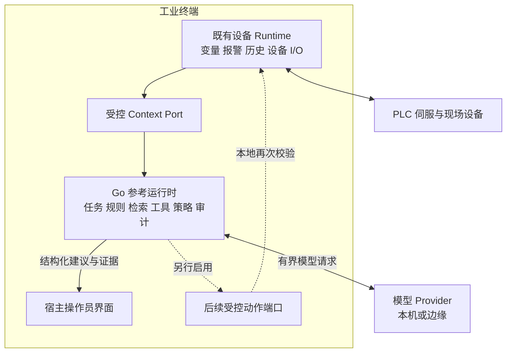
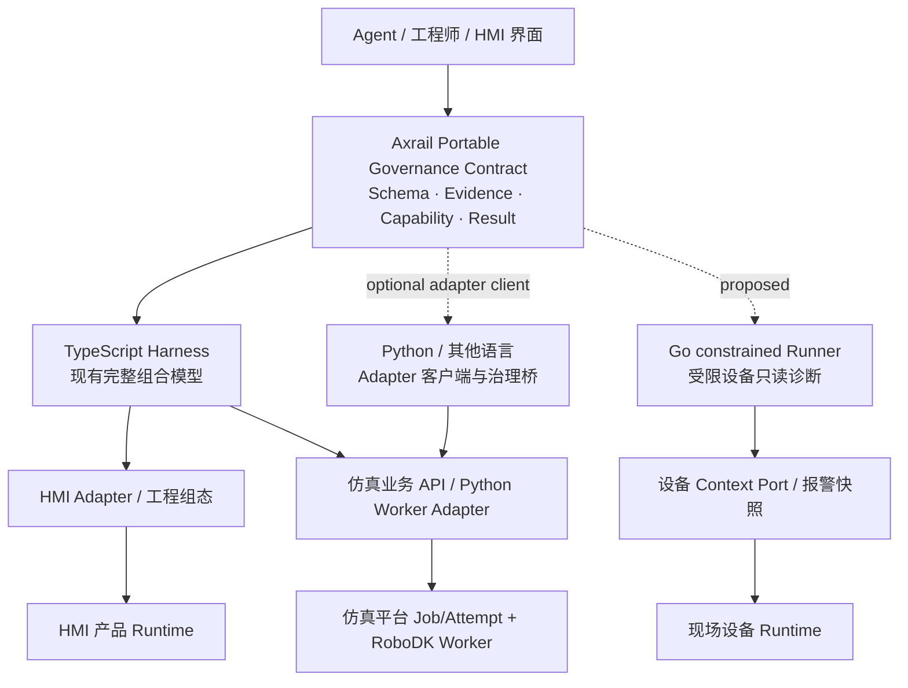

# RFC 0014：跨语言工业 AI 治理契约与受限设备 Go 运行时

状态：**提议，等待维护者评审；尚未实现或通过设备认证**

## 摘要

**Axrail 的长期目标是可被多种工业软件和语言实现共同遵守的 AI 执行治理契约，而不是「把现有 TypeScript Harness 全部重写为 Go」。** 当前受支持的完整组合模型继续为 TypeScript §HarnessRuntime§ + §AdapterHost§；本提案在保留其执行语义的前提下，定义语言中立的治理协议与跨实现一致性机制，并探索有限资源 Linux/ARM64 工业终端的 Go 受限参考运行时。

需求来自三个相互独立的验证场景：（一）AI-native HMI/组态编辑，通过 TypeScript SDK + 产品 Adapter 执行有审查的工程修改；（二）机器人焊接仿真平台，通过 Axrail Adapter/受控服务边界连接已有 Python 仿真内核与 RoboDK/Blender 等 Worker；（三）工业 HMI 设备和边缘网关，通过本地 Go 参考 Runner 完成只读数据采集、报警诊断、离线规则和受限模型调用。第三种是本 RFC 的新增部署场景，**不要求前两种迁移语言**。三种应用是拟验证集成路线，不应被误述为均已实现 Axrail 接入。

首批请求评审和交付：协议范围与能力配置、Schema/规范化证据、TS/Go 共同测试向量、无云密钥的 Go 只读诊断样例、ARM64 同负载实测、三个场景的集成验收定义。Go SDK/daemon、Python SDK、跨设备动作、完整事务移植均是后续单独 Gate 的决策，不因合并此 RFC 而承诺发布。

**当前状态：RFC 设计，非实施批准；无 Go SDK、Go Runner 的正式发行物和真实设备认证。** 现有 Node.js/npm 版本、§@axrail/model-ai-sdk§ 的模型供应商抽象及 v0.2 交付路径不变。下面第 13—22 节给出三场景产品边界、可移植契约、实施顺序、验收矩阵和发布治理。

## 1. 使用场景与问题

工业终端通常已经运行图形宿主、设备通信、报警、历史记录及操作员界面。Agent 的资源预算来自这些必要功能运行后的剩余量。集成方可能已有 Go 设备服务，希望通过稳定端口组合 Agent 能力，并在 Agent 或模型异常时保持设备 Runtime 可用。

典型场景是：设备报警后，Agent 读取有限的现场状态和趋势，检索匹配型号/固件的知识，生成附带证据的解释与人工巡检步骤。持续控制、运动闭环、急停和安全联锁仍由设备控制系统承担。

现有 Axrail 已有可借鉴的边界：

- [HarnessRuntime](../../packages/harness/src/runtime.ts) 组合工具、策略、审批、事务及 Adapter，并支持 provider-bound ChangeSet 执行。
- [执行语义](../../docs/execution-semantics.md) 区分只读超时与副作用的 `execution_uncertain`。
- [审计模型](../../docs/audit-model.md) 区分观察性事件与副作用前必须持久化的 checkpoint。
- [RFC 0013](../0013-ai-sdk-provider-convergence/README.md) 将模型供应商协议与工具执行权限分离。

这些治理原则适用于设备场景，但当前 npm 实现需要 Node.js；它不能直接作为 Go 库嵌入已有设备进程。新增 Go 路线的价值是提供部署选择与受限实现，并非预先断言 Node.js 在所有设备上不可用。资源收益必须用同工作负载比较。

### 三个验证场景的边界

| 场景 | 业务所有者及现有实现 | 首选 Axrail 集成 | 本 RFC 承诺范围 |
| --- | --- | --- | --- |
| AI-native HMI / 工程组态 | HMI 产品持有画布、选区、工程模型和设备部署权 | TypeScript Harness + HMI Adapter + ChangeSet/Transaction | 形成共享协议的工程修改验证用例；不改写 HMI 产品 |
| 焊接仿真与数字孪生 | 仿真平台持有 Job/Attempt、Workcell、模型文件、结果发布；Python Worker 驱动 RoboDK 等 | TS Harness 或远程治理桥 + Python Adapter/服务端口 | 定义并验证集成合同；不改写仿真调度或 Worker |
| 工业 HMI 设备 / 边缘网关 | 设备 Runtime 持有采集、报警、现场 I/O 和最终安全约束 | Go 受限 Runner + 本地 Context Port；或边缘 TS Harness | 首期只读诊断、离线规则、资源/恢复实测；设备写入另设 Gate |

现有焊接仿真平台仓库：[§bookmagic-co/biz-welding-sim§](https://github.com/bookmagic-co/biz-welding-sim)；Cortex 连接项目的治理边界见 [§docs/integrations/cortex.md§](../../docs/integrations/cortex.md)。真实产品接入、私有协议、客户工程与现场设备参数不进入本公共 RFC。

## 2. 请求维护者提供的交付物

| 交付物 | 内容 | 完成证明 |
| --- | --- | --- |
| 受限设备配置说明 | 功能子集、能力协商、资源边界、支持矩阵 | 明确支持/不支持项和可重复场景 |
| 语言中立治理契约 | 工具/目标/主体/证据身份、审批绑定、结果与错误语义 | Schema、版本策略及正反测试向量 |
| Go 参考程序 | 有限任务状态机、只读工具、规则、模拟模型/设备、持久化恢复 | 无云密钥可运行的 Linux ARM64 样例 |
| 一致性测试包 | 对 TS 与 Go 执行共同案例，比较语义结果 | 每项标记支持等级；不虚报完整 API 一致 |
| 设备测量报告 | 二进制、依赖、RSS/PSS、CPU、启动、存储与恢复 | 固定版本、负载、板型与原始采集记录 |

建议使用暂定名称“constrained-device profile”和“Go reference runner”。最终包名、仓库位置、CLI、支持等级由维护者决定；本 RFC 中的名称不是已发布接口。

## 3. 三种可行路线

| 路线 | 设备运行内容 | 优点 | 代价与限制 |
| --- | --- | --- | --- |
| A：边缘 TS Harness + 本地 Go 执行端 | Go 的上下文与受控端口，模型/编排在边缘 | 最大限度复用当前 Harness | 网络断开时仅本地规则可用；需要可靠认证与恢复协议 |
| B：独立 Go 受限运行时 | Go 规则、任务、工具治理、审计；推理位置可选 | 编排可本地运行，减少额外语言运行时部署项 | 需要维护跨语言语义与一致性测试 |
| C：设备侧 TS Harness | 当前 Node.js 与受限 Adapter | 复用现有实现最快 | 需实际验证依赖、资源与目标 BSP；不能先假定可行或不可行 |

建议先冻结共同契约，再实现 B 的只读样例，并以 A 作为低资源或集中模型场景的部署选择。C 作为对照测量基线。若维护者当前无力维护 Go 实现，可以先接受契约与测试向量，让集成方实现相同子集。

## 4. 推荐的运行边界



Go 运行时建议从一个独立进程开始，内部按职责分包。Context、Task、Policy、Store 等逻辑模块不必变成多个微服务。集成方以后可按实测决定是否嵌入已有 Go 进程，但必须重新评估故障、内存与升级隔离。

设备 Runtime 保有变量、报警和 I/O 权威；Agent 不新增一条绕过 Runtime 的 PLC 轮询/写入链。对外协议适配器、MCP 或模型供应商 SDK 均不能获得旁路执行权限。

本地优先评估 Unix socket 上的受限请求/事件接口；跨主机使用受认证的加密通道。传输不是可信身份来源：请求内自填的 actor/provider 字段不能授予权限，宿主必须绑定进程或已验证会话身份。

## 5. 最小治理契约

协议应描述行为而非序列化 TypeScript 类、闭包或内部对象。现有字段先建立映射；不能仅因名字相同就宣称兼容。

| 对象 | 最小语义 | 必须拒绝的情况 |
| --- | --- | --- |
| 能力声明 | 稳定能力 ID、版本、输入输出 Schema、effect/risk、provider、支持等级 | 未知版本、伪造只读标记、歧义 provider |
| 调用上下文 | 可信主体、目标、作用域、关联 ID、deadline、版本前提 | 跨主体/目标复用授权，失效作用域 |
| 现场观察 | 值/类型/单位、质量、源/接收时间、序号、启动 epoch | 陈旧或坏质量数据冒充实时事实 |
| 结构化变更 | 参数、目标版本、预条件、不可变摘要 | 审批后修改参数或目标 |
| 审批证据 | 主体、角色、变更摘要、provider/目标、到期时间、策略版本 | 模型自称已获批准；重放或过期审批 |
| 执行结果 | 成功/拒绝/失败/取消/结果不确定、回读证据、重试语义 | 超时直接记为未执行；ACK 直接记为物理完成 |
| 审计记录 | 调用、checkpoint、结果、关联和证据身份 | 审计不可用仍越过必须持久化的副作用边界 |

支持等级可沿用 `exact / compatible / degraded / unsupported` 的表达方式，但应分别声明具体能力。首期缺少 ChangeSet mutation 或人工审批实现时，应报告 `unsupported`，不能给出空实现的成功结果。

### 跨语言一致性要求

- 冻结 JSON 编码、数值精度、时间、null/缺失字段、枚举和未知字段策略；大整数与十进制值不得依赖 JS/Go 的默认转换恰好相同。
- 对需要审批绑定的文档，规定确定性编码/摘要算法，并提供 TS/Go 共同 golden vectors。不能直接对任意语言 map 的 JSON 输出求哈希并假定一致。
- Schema major 不兼容或必需能力缺失时拒绝执行；可选能力缺失时显式降级。
- 共同测试验证协议语义，不承诺跨语言内部数据结构、二进制格式或全部 npm API 的一致性。

## 6. Go 参考程序的首期范围

建议提供以下包级边界，具体目录由实现阶段确定：

```text
runner       生命周期、健康、有限队列与资源配置
task         有界状态机、截止时间与恢复
capability   编译期工具注册、Schema 与身份校验
policy       确定性授权，默认拒绝
context      受限快照、事件、质量与新鲜度
model        小接口与供应商适配；模拟模型默认可用
store        Run、checkpoint、建议与审计
adapter      宿主业务端口与模拟器
conformance  可移植测试向量与结果报告
```

首个样例允许读取上下文、检索故障知识和保存建议/人工任务；不提供设备写入、任意 Shell、任意网络工具或动态下载代码。声明式 Skill 只引用已注册能力及资源预算。可执行扩展通过受审版本交付，第三方脚本/WASM 留待独立设计。

Go 模型边界只返回文本或结构化工具请求；工具始终由本地治理层执行。适配器传播 deadline/取消、限制请求和响应字节、最大步骤、并发与重试。若由边缘 TS 服务复用 AI SDK，Go 端接收结果仍需本地校验；边缘服务不能注入有执行权的回调。

## 7. 资源目标与测量方法

以下数字仅是首轮实验目标，**不是已有 benchmark 或最低硬件要求**。设备需先测既有 Runtime、图形栈和系统峰值，再预留恢复空间。Go 与 TS 方案使用相同 fixture、相同模型位置和功能子集比较。

| 指标 | 初始目标/方法 |
| --- | --- |
| Agent 空闲 RSS | 争取 ≤64 MiB；记录 PSS、Go heap 与常驻知识规模 |
| Agent 峰值 RSS | 争取 ≤128 MiB；覆盖 TLS、最大上下文、突发事件与持久化 |
| 模型并发 | 默认 1；模型权重和推理进程单独计量并纳入整机报告 |
| Run 上限 | 初始最多 4 个工具步骤、总时限 30 秒；均可配置且有硬上限 |
| 输入/输出 | 初始上下文 64 KiB、模型响应 128 KiB；流式读取阶段限制 |
| 队列 | 事件数和字节数双上限；普通遥测合并，事件缺口可观察 |
| 存储 | 固定保留策略、配额、WAL/索引预留与磁盘满行为 |
| 共存影响 | 测 Agent 开/关时宿主交互和采样 P95；初始增幅目标 ≤10%，并冻结绝对阈值 |
| 长稳 | 同工况连续 72h；观察内存、队列、存储增长和恢复 |

`GOMEMLIMIT` 是软限制，不能代替 RSS/cgroup 限制；`GOMAXPROCS` 也不是进程 CPU 配额。应同时测整个进程树、native/mmap 分配、OOM 行为与宿主服务影响。参见 [Go GC Guide](https://go.dev/doc/gc-guide)。

基准报告应记录板型、RAM、内核/libc、工具链、固件/程序摘要、事件速率、上下文大小、知识大小、模型位置及采集方法。不要求设备具备本机 LLM/NPU；推理吞吐不能用芯片 TOPS 数字替代。

## 8. 失败、持久化与副作用

### 只读任务与事件

事件至少一次交付，通过启动 epoch、事件 ID 与 Skill 版本去重。完成结果持久化后再推进 checkpoint。消费者落后超过保留窗口时报告 gap，重新获取快照；不能静默丢失后宣称诊断证据完整。

规则与故障码查询在模型离线时仍可用。工程、设备绑定或知识版本变化使旧任务失效或要求重采样。Agent 重启后，只读任务可按策略重建；过期建议不自动补发。

### 后续动作

动作能力单独启用，并保持以下不变量：

1. 每个请求在设备侧有最终校验，审批绑定确切参数/目标/状态与时限。
2. 对副作用，在执行前写入所需的持久化 checkpoint；默认 best-effort 审计不能直接当生产动作策略。
3. 通信超时或取消不保证动作未发生；保留 `execution_uncertain`，只有经过明确证明的幂等操作才可自动重试。
4. 进程在设备执行后、结果记录前退出时，恢复流程先回读核对；不能默认重放。
5. ACK 和设备读回分别记录。物理动作不承诺通用 rollback；补偿能力由具体设备 Adapter 声明。
6. 模型/Agent/操作员 UI 不接管安全 PLC、急停、运动闭环或安全联锁。

本地业务 Runtime 对操作合法性仍有最终约束，Go runner 不创建绕过既有域规则的第二套执行权威。只有已通过共同测试的治理子集才可声称与 Axrail 对应能力兼容。

## 9. 一致性与设备测试矩阵

| 测试 | 预期行为 |
| --- | --- |
| 同名工具由多个 provider 提供 | 未明确绑定时失败；禁止误选 |
| 工具宣称只读但实际 effect 不符 | 拒绝或按可信注册策略重分类 |
| 审批过期、参数变更、跨目标重放 | 副作用前拒绝 |
| 必需审计写入失败 | 副作用前停止，不虚报已提交 |
| 外部作用完成后观察性日志失败 | 保留真实结果，报告审计异常 |
| 副作用工具超时或设备失联 | 结果不确定，禁止盲目重试 |
| 陈旧值、坏质量、时间异常 | 显式降级或证据不足 |
| 事件重复、乱序和重启 epoch 变化 | 有界去重、缺口检测与恢复 |
| 模型无效 JSON、越权请求或超大响应 | 拒绝并释放资源，不扩大工具权限 |
| 磁盘满、进程退出、掉电 | 不虚报完成；可判定的恢复状态 |
| Agent 崩溃/模型离线 | 宿主画面、报警和设备 Runtime 保持工作 |
| 未实现的高级事务/插件能力 | 返回 unsupported，不模拟成功 |

第一批共享 vectors 应覆盖数据规范化、provider 绑定、过期/版本冲突、只读结果和超时语义。副作用测试可在模拟 Adapter 上提前定义，真实动作支持必须通过独立实施与设备验收。

## 10. 分阶段建议

1. **契约评审**：确定部署路线、最小治理子集、身份/摘要、错误和支持等级；补齐 shared vectors。
2. **可运行 Go 样例**：确定性模拟模型 + 模拟设备 + 只读诊断 + 持久化恢复，无云账户依赖。
3. **ARM64 实验发布**：提供可复现构建、校验摘要、依赖/许可证清单、启动与卸载说明，并报告资源数据；适用时保持纯 Go，CGO 项明确 ABI 要求。
4. **宿主/设备试点**：接入一个真实宿主的只读 Context Port，完成断网、故障隔离与长稳；不把桌面测试代替设备验证。
5. **支持策略决策**：根据一致性和维护成本，确定 Go SDK/daemon 的发行、版本、漏洞修复与支持矩阵；动作能力另设门槛。

不预设维护者承诺的工期。OpenHarmony、其他 OS、动态插件、本地模型引擎和完整事务 API 移植均需单独评估。

## 11. 待维护者决定

- 接受语言中立契约作为公共接口，还是仅发布嵌入式集成指南？
- Go 参考实现放在本仓实验目录、独立仓库，还是由集成方实现并提交一致性报告？
- 哪些语义进入第一批必须一致的子集，哪些明确 unsupported？
- 路线 A 与 B 中谁拥有最终审批和恢复记录；跨网络场景如何证明身份与防重放？
- 初始设备资源目标、长期维护与跨语言回归责任由谁承担？

## 12. 公开信息边界与兼容性

本提案使用通用工业场景，不包含客户工程、内部端点、凭据、设备地址、私有协议或安全逻辑。产品厂商的 Adapter、设备语义和知识留在其产品侧，Axrail 保持 vendor-neutral。

这是文档 RFC。合并文档意味着保留讨论与设计依据，不等于批准实现、发布 Go 稳定 API 或变更现有 Node.js 支持基线。获得维护者反馈后，应以独立实现 PR 推进每个可验证交付阶段。

## 13. 产品定位：一个协议、多个部署实现

### 13.1 不变的架构原则

- **统一语义，不是多套核心权威。** Axrail 的跨语言规范描述能力、目标身份、不可变证据、治理结果、错误与不确定性；不承诺跨语言内部类或完整 npm API 等价。
- **受支持的主实现保持稳定。** 现有 TypeScript `HarnessRuntime` / `AdapterHost` 是实现和回归基线；`@axrail/core` 仍属私有实验性研究，不能借本 RFC 推成第二内核。
- **集成优于重写。** HMI 继续沿用产品现有技术栈；焊接仿真继续沿用 Python/Worker/RoboDK 架构；Go 只服务于确有设备侧部署收益的场景。
- **多语言 SDK 不等于多份完整 Harness。** 后续可以提供 Go 客户端 SDK、受限 Go Runner、Python Adapter 客户端，但每种必须分别声明 `profile`、已支持的能力和维护责任；不得混称。
- **业务执行权威不迁移。** Axrail 只对其所治理的工具/变更负责，HMI 编辑器、仿真调度器、设备 Runtime 对各自领域状态和安全约束保持权威。

### 13.2 拟议产品分层



`Portable Governance Contract` 是拟议规范层（Schema、版本与向量），**不是**现有可安装软件包、数据库、云控制平面或另一个执行服务。图中虚线均为候选接口，不代表已有实现。

### 13.3 拟议支持矩阵（不得宣传为已发布）

| 接入形态 | 当前/目标 | 治理范围 | 不提供的能力 |
| --- | --- | --- | --- |
| TypeScript Harness + Adapter | 当前支持路径（具体 API 以版本为准） | 完整现有 Tool/Policy/Approval/Transaction 架构 | 不自动提供特定厂商设备协议 |
| Go 只读参考 Runner | 本 RFC 拟议实验实现 | 受限 Task、Context、Policy、Audit、只读 Tool、模型适配、恢复 | 工程变更、L2—L5 动作、通用事务、动态任意代码 |
| Go SDK（嵌入式） | 待性能/支持 Gate | 仅根据共同向量实测确定 | 不自动等同完整 TypeScript SDK |
| Python Adapter / client | 可作为后续集成实现；本 PR 不开发 | 调用受治理服务、转译领域能力/证据 | 不另造绕过 Harness 的并行审批和事务权威 |
| 其他语言 SDK | 长期候选，未承诺 | 从语言中立契约选择性支持 | 不预先宣称功能完整 |

## 14. 三个领域场景：端到端验证定义

### 14.1 场景 H：AI-native HMI/组态工程（现有优先级）

建议参考链路：

```text
产品画布/选区 → Selection Context（含 provider/target/version）
→ Axrail Agent / Tool 生成 ChangeSet → Preview
→ Policy + Validation + Approval → Transaction
→ HMI Adapter 对目标工程执行 → Verify / Commit 或显式不确定性
```

- 输入：明确选择的工程/页面/组件、版本、允许修改范围、设备接入配置的脱敏引用。
- 输出：不可变 ChangeSet 摘要、预览证据、审批/拒绝、工程结果与回读。
- 负面验证：选区过期、provider 歧义、越范围修改、审批后参数变化、部署断线/版本冲突均阻断或返回真实状态。
- 责任边界：Axrail 不实现画布、拖拽、设备控制逻辑；HMI Adapter 不绕过主治理链。
- 验收 Gate：与 [RFC 0009](../0009-transactional-mutation/README.md) 的真实 HMI vertical slice 共同验收；此 RFC 仅贡献跨语言证据和可移植合同，不改变 v0.2 排期。

### 14.2 场景 W：焊接仿真平台（新增的非 HMI 工程验证）

以现有 `bookmagic-co/biz-welding-sim` 的 Workcell/Station Digital Twin、`Job/Attempt`、Python 仿真内核与独立 Worker 为基础，拟议链路：

```text
客户图纸/工件/布局（保留在产品私有存储）
→ 工程方案与仿真任务提议 → 仿真 Adapter / Job API
→ 权限/资源预算/工程版本检查 → 启动独立 Worker
→ RoboDK IK/FK/碰撞/节拍等证据 + 其他渲染产物
→ 验证、结果归档、人工评审 → 受控分享/发布
```

- **不迁移语言：** Axrail 可由 TS Harness 编排/治理，Python 内核和 RoboDK Worker 保持原位；跨进程采用已有 API/Job 合同或后续经批准的 Adapter bridge。
- **资源型副作用不是只读：** 任务启动、算力消耗、文件创建/覆盖、产物发布、共享链接权限等均需按真实 effect/risk 分类，不能一概标为 L0。
- **治理范围：** 将模拟方案、工件/Workcell/版本引用、提交者、预算、执行节点、证据位置、Job/Attempt ID 关联为可审查记录；有外部发布/覆写时单独审批。
- **失败语义：** Worker 断线或返回超时，不推定任务未执行；通过 Job/Attempt 状态与产物读回收敛。不可重放的计算或写入按幂等键、状态和业务端口约束处理。
- **安全边界：** 仿真结果不等于真实机器人运动安全认证；真实机器人/PLC 指令执行超出本场景，需独立动作与安全 Gate。
- **验收：** 一条使用公开虚构数据/模拟 Worker 的从提议、提交、验证到结果审计链，且能覆盖重复提交、预算拒绝、Worker 超时及失败恢复。真实 RoboDK 设备和生产许可证测试单列证据，不以 mock 冒充。

### 14.3 场景 E：工业 HMI 终端 / 边缘网关（本 RFC 主要新增目标）

```text
设备已有采集/报警 Runtime → 受限 Context Port
→ Go Reader / 规则与故障知识 → 有界模型请求（可选）
→ 引用质量、时间、版本的诊断建议
→ 产品 UI / 人工巡检任务 / 审计与恢复
```

- 首期 **L0 只读**：报警、趋势、设备状态、知识检索；无设备写、远程 shell、任意 URL/脚本、控制闭环和未经批准的云上传。
- 无模型、无云凭据、网络断开时，确定性本地规则及最近的合格诊断证据仍可工作；不能以陈旧值冒充现场实时值。
- Runtime 崩溃、Agent 超时或内存压力，不得破坏本来的采样、报警、画面及安全功能。
- 设备写入能力必须使用新的 RFC/Implementation Gate，不能因现有 TS 的 L2/L3 功能或本文件的“后续动作”文字而自动启用。

## 15. 跨语言协议：权威、身份和演进

### 15.1 单一治理语义来源与版本策略

- 以 **TS 当前真实行为 + 已批准 RFC** 作为初始语义输入，从行为测试提炼 `portable-profile-v0`。规范/向量通过设计 Gate 后才可标记为公共协议；不是直接把 TS 对象转成 JSON。
- 建议 `protocol-major.minor` 与 `profile-id/profile-version` 双维度协商。未知 major / 未满足 required capability **fail closed**；可选能力降级须返回 `degraded` 和原因，不得静默接近成功。
- 能力包括 `read-context`、`readonly-tool`、`bounded-task`、`durable-audit`、`approval-bound-effect`、`changeset-transaction` 等；每一能力各自声明 `exact/compatible/degraded/unsupported`，不得以“兼容 Axrail”一个布尔值概括。
- 变更流程：Schema PR → TS golden vector → Go/客户端验证 → 兼容性报告 → 独立发行判断。协议不兼容的 major 变更必须有迁移说明。

### 15.2 最小交换封套（概念字段，尚非冻结 Schema）

| 字段族 | 建议属性 | 约束 |
| --- | --- | --- |
| `protocol/profile` | major/minor、profile、必需能力 | 握手后固定于一次 Run；不支持则拒绝 |
| `request identity` | requestId、correlationId、session/runId、deadline | 唯一性/重放窗口由可信 Host 端核验 |
| `principal binding` | 认证会话主体、scope、来源设备/项目 | 不采信模型文本或客户端自填 actor |
| `target binding` | providerId、targetId、targetVersion/epoch | provider 不能歧义；版本变化触发重新验证 |
| `capability/effect` | id、schemaVersion、effect、risk、资源预算 | 服务端可信注册目录是权限上限 |
| `observation` | value/type/unit、quality、sourceTime、receiveTime、sequence、epoch | 质量差/时序异常必须显式报告 |
| `evidence` | canonicalProfile、digest、policyVersion、skillVersion | 审批、执行和审计引用同一不可变内容 |
| `result` | status、effectUncertain、retrySafe、readback、auditState | `timeout` 不可覆盖已经可能发生的副作用 |

编码规则应明确 UTF-8、null/缺失、枚举扩展、最大字节长度、UTC 时间精度、整数/十进制的字符串形式、对象键序、浮点拒绝范围与重复字段。**不得直接套用新的哈希规范替换现有 ChangeSet SHA-256 证据**；先用 TS 现有摘要产生正反 golden vectors，验证与拟议规范化档案的一致性，再单独决定映射/迁移规则。

### 15.3 认证与授权链（特别是跨设备）

1. **身份来源：** 本机 socket 以受控进程身份和 OS peer credential/权限为候选；跨主机以经验证的 mTLS 或签名会话/短期令牌为候选。运输层安全不自动等于业务授权。
2. **Host 绑定：** 可信 Host 将主体、角色、provider、项目/设备/工件目标及授权范围绑定到会话，覆盖或拒绝请求中不可信的 actor/provider 自声明。
3. **权限下沉：** 上游 TS/模型只能产生意图/建议；本地 Go Runner 与设备 Adapter 仍依注册能力、版本与策略做最终校验。模型供应商 SDK、MCP、任意第三方 Tool 无旁路权限。
4. **审批证据：** 未来的动作授权须绑定不可变操作摘要、主体、provider、具体目标/版本、有效期、策略版本、审批角色与一次性/幂等语义；跨主体/设备/租户/项目重放必须拒绝。
5. **恢复与撤销：** 记录会话终止、重启 epoch、令牌过期/撤销；网络恢复后不能将离线期间的旧批准自动提升为执行权。
6. **安全边界：** 模型推理与诊断永不替代现场急停、联锁、安全 PLC 或运动闭环；物理动作必须另行完整设计与现场认证。

### 15.4 上下文最小化与信息流控制

- 设备 Context Port 采用字段级 allowlist、采样速率/数量上限、来源与质量标记、敏感级别和项目/租户范围；不让 Go Runner 任意扫描内存、文件或 PLC 地址。
- 默认 **不上传原始高频数据、客户 CAD、工程参数、控制策略、凭据**；模型侧只能访问经过脱敏和预算裁剪的快照，远程上传需具体策略允许。
- 知识检索结果、设备文本、文档和 MCP 响应均视为非可信输入，不得包含能直接改变本地策略、凭据或工具权限的可执行指令。
- 日志和审计保存摘要、来源、版本、关联 ID，不保存隐藏模型思维链或非必要敏感原文；支持存储配额、保留/删除和事故取证要求。

## 16. 两种部署拓扑下的执行权威

| 拓扑 | 任务/模型编排 | 决策与执行权威 | 离线与恢复 |
| --- | --- | --- | --- |
| A：边缘 TS Harness + 设备 Go Context/Executor 端口 | TS Harness 负责上游 Run 与治理 | TS 治理不能替代设备端最后校验；Go 端首期只读，动作另定双端策略 | 设备侧规则继续运行；网络任务以 ID/epoch 对账，禁止盲目重放 |
| B：设备独立 Go 受限 Runner | Go 管理有限 Task、规则和可选模型调用 | Go 仅对声明的设备本地 **只读** 能力实施治理；设备 Runtime 拥有数据与最终安全权威 | 本地 Run/审计可恢复、模型缺席可规则诊断 |
| C：设备 TS Harness（对照基线） | TS 本地 Harness | 现有 TS 治理 + 设备 Adapter 的最后校验 | 实测符合资源要求时可直接采用，不人为排除 |

**不得设立两个各自认为拥有最终物理动作授权的控制平面。** 若未来允许写操作，应在单独决策中明确审批的唯一权威、证据同步、租约/撤销、双端 gate、幂等、回读与不确定性收敛；当前一律 `unsupported`。

## 17. SDK、代码布局与发布策略（均为提议）

建议分阶段在同一 monorepo 中先保留可审阅的 `rfcs/0014-...`、`schemas/` 或 `protocol/` 规范与 `tests/conformance/` 向量；后续若批准 Go 实验，优先放 `experimental/go-runner/` 或 `examples/constrained-device-go/`，避免提前冻结 `go.mod` 模块路径、CLI 及长期兼容承诺。实现和结构选型应另开 PR，遵守既有包/锁版本策略。

- **TypeScript：** 继续支持既有 npm、Node 版本和 CI；主产品交付不能被 Go 性能实验阻塞。
- **Go：** 第一产物为参考程序/测试夹具和 ARM64 可复现构建。是否独立 Go Module SDK、是否以 daemon/静态可执行文件发布，依据后续 Gate 定夺。
- **Python：** 焊接仿真先做 Adapter/Job API bridge；仅当至少两个独立 Python 集成需要通用库且满足维护标准，才考虑正式 Python SDK。
- **安全与供应链：** 公开 SBOM/依赖许可证、构建参数与 SHA-256 校验；指定漏洞响应和升级/回滚机制；未认证平台不可被标为正式支持。
- **无强制云端：** 设备可完全离线规则诊断；云密钥、供应商 Token 和现场设备地址不得作为参考样例硬编码。Go 和 TS 性能比较必须保持相同任务、模型位置、数据输入与限额。

## 18. 跨语言一致性与多场景验收矩阵

| 测试类别 | 最少测试向量/案例 | 通过条件 |
| --- | --- | --- |
| 编码与摘要 | JSON null/缺失、Unicode、数字精度、无序键、时区/时间精度、未知字段 | TS/Go 对受支持字段输出同一规范语义/摘要；不支持输入一致拒绝 |
| Provider 与能力 | 同名工具多 provider、虚报 L0、未知 schema/capability、降级 profile | fail closed、无隐式路由或虚假成功 |
| 身份与重放 | 伪造 actor、跨设备/租户/工程复用、审批过期、nonce/id 重放 | 请求拒绝且保留可审计原因 |
| 上下文安全 | 时钟回拨、质量差、陈旧值、事件 gap、超出限额、提示词注入 | 不产生虚假实时证据或越权执行 |
| 失败恢复 | 磁盘满、模型断线、Runner 崩溃、重启 epoch、ACK 丢失 | 状态可解释，不盲目重试副作用 |
| HMI vertical slice | 选区 → ChangeSet → 预览 → 审批 → 提交 / 拒绝 | 由现有 TS 基线验证；本 RFC 仅引用结果并验证相同证据语义 |
| 焊接仿真 slice | 模拟 Workcell → Job/Attempt → mock Worker → 验证/产物；预算拒绝/重复任务/超时 | 已有 Python 执行权威不被替换；跨服务关联 ID 和结果证据可追踪 |
| 设备只读 slice | 报警 → 受限快照 → 规则/模型 → 诊断建议；断网/重启 | 无云密钥可运行、数据不越界、设备业务 Runtime 不受损 |
| 资源共存 | Go/TS 相同 fixture；RSS/PSS/CPU/启动/存储/P95/72h | 报告原始数据、测试环境和失败项；不以目标值冒充实测 |
| 兼容和发布 | 各 profile 功能清单、README 声明、安装/升级/卸载 | 发布路径清晰，unsupported 不被宣传为已实现 |

首批最低向量：规范化与数字、provider/target 身份、未知版本、超时/`execution_uncertain`、事件 gap、只读建议、崩溃恢复。副作用模拟测试可定义但不等于允许设备动作。验收覆盖率需要由专门 Gate 基于共同向量与各 profile 分别统计，不能把 TS 的测试数直接归为 Go 合格。

## 19. ARM64 性能与故障隔离试验设计

原第 7 节的 64 MiB 空闲 RSS、128 MiB 峰值 RSS、最多 4 工具步骤/30s、P95 ≤10% 增幅及 72 小时均为 **实验假设，不是已达成指标**。在实际设备 Runtime 的资源余量测定后，可按不同内存档位、不同事件速率建立资源 profile。

1. 记录设备板型、BSP/内核、内存、图形和通信 Runtime 常态/峰值、采样及 UI P95，再计算可用预算。
2. 对同一 fixture 在 TS/Go 的本地模型、边缘模型、无模型规则三种模式进行可比测试；LLM 权重、网络进程和 Host Runtime 独立计量并报告整机开销。
3. 注入 CPU 抢占、内存压力、磁盘耗尽、进程杀死/掉电、网络 flap、超大模型响应、长期事件积压；验证无宿主报警丢失和安全路径失效。
4. 报告 `RSS/PSS`、CPU 限额与被节流时间、启动、队列延迟、文件描述符、I/O 和数据丢包/gap；`GOMEMLIMIT`/`GOMAXPROCS` 不视作硬资源保证。
5. 结果逐项说明采样方法、次数、原始日志和重复性；达不到试验目标时允许 `degraded/unsupported` 或推荐部署 A/C，不能为了达标降低已有 Runtime 优先级。

## 20. 分阶段实施计划、依赖与 Gate

| Gate | 交付内容 | 通过条件 | 不通过时 |
| --- | --- | --- | --- |
| G0：RFC 决策 | 三场景范围、权威归属、风险等级、维护责任 | 确认统一治理语义；明确只读首期和 v0.2 不阻塞 | 保留 RFC 为 Proposed；不开实现 PR |
| G1：契约 + vectors | Schema 草案、`portable-profile-v0`、TS golden vectors、负面测试 | 在 TS 现有行为上证明协议与摘要映射，版本拒绝/能力协商可测 | 收窄字段或返回 TS-only |
| G2：Go 只读原型 | mock 模型/设备、离线规则、任务持久化/恢复、受限 Adapter | 无云凭据可跑共同向量；没有未治理的执行/写入入口 | 停在实验层，不对外称 SDK |
| G3：真实 ARM64 | 可复现构建、资源报告、断网/故障隔离/72h、设备 Context Port | 业务 Runtime 无退化越界，缺陷记录闭环 | 优先部署边缘 TS + 设备只读端口 |
| G4：第二工程场景 | HMI 与仿真两类 mock/可公开用例，共享追踪与错误语义 | 验证协议不是 HMI 特化，且不要求 Python/Worker 改写 | 修订 Adapter/协议，不扩大语言 SDK |
| G5：支持与发版 | Go Module/daemon 是否存在、版本矩阵、维护和安全支持方案 | 独立批准后才称 Go SDK 或正式 Runner | 保留参考实现/实验，不发布稳定 API |

**依赖和优先级：** 既有 `RFC 0009` Transactional Mutation、真实 HMI Adapter 和 v0.2 稳定化仍按原路线推进；本 RFC 的 G0—G1 可并行做文档与共同测试向量，但 G2 及之后需独立任务、资源与审批。G4 可复用既有 HMI/焊接平台的公开 mock，不要求在生产系统直接安装新 Runner。Go 的 L2—L5/物理动作不包含在这些 Gate 中。

### 任务分工建议（角色不是已任命人员）

- **Axrail 协议维护者：** 规范语义、Schema、conformance、兼容策略、TS 回归。
- **Go Runner 负责人：** 受限实现、设备测试、故障隔离、二进制与安全更新。
- **HMI 集成负责人：** 选区/ChangeSet/Transaction vertical slice 与产品侧真实证据。
- **焊接仿真集成负责人：** Job/Attempt 关联、Python Worker Bridge、预算与产物审计的 mock/脱敏证据。
- **治理审查者：** Scope/Owner/Task/Decision/Waitpoint/CI 证据及支持 Gate；Cortex 仅治理开发流程，不替代 Axrail 工程执行权。

## 21. 决策记录与评审清单

### 21.1 已在此 RFC 中明确的设计倾向（待维护者接受）

1. TS 是当前受支持的完整 Harness 基线；不因引入 Go 重写或停止 Node/npm 版本线。
2. 目标是可移植治理契约 + 受限 Go 只读执行配置；不承诺完整 Go/Python SDK。
3. HMI、焊接仿真、工业终端是三个不同部署/业务场景；通过 Adapter 共享协议和证据，领域所有权不迁移。
4. 首期设备模型不执行任何写操作，Go Runner 不自带工业控制权威。
5. 正式 Go SDK/Runner 支持要有跨实现一致性、设备性能和维护/安全 Gate 的证据。

### 21.2 仍需 G0 裁决的开放问题

- 是否把 `portable-profile-v0` 作为 Axrail 对外正式协议，还是先仅作为参考集成合同？
- TS 现有证据摘要与跨语言确定性编码如何版本化映射，已有审批记录如何保持有效？
- 一致性套件由谁维护，采用哪个目录、Schema 工具和最低负面向量集合？
- Go 参考程序先放 monorepo 实验目录还是独立仓，谁负责 ARM64 固件兼容和维护？
- 设备 A/B 拓扑如何建立可信身份/时间和事件 epoch，是否仅保留只读权限？
- 焊接仿真先做 mock Adapter 还是受控真实服务试点，如何采集不含客户数据的可公开验收证据？
- v0.2 集成冻结期间哪些合同允许并入、哪些必须 defer 到后续版本？

## 22. PR 合并的准确含义

本 PR 只更新 RFC 与架构索引，**合并 = 接纳问题陈述和拟议设计记录，不等于 G0 通过，更不等于 G1—G5 开发、API 冻结或公开承诺。** 实施需先记录所有者、范围、审批、失败停止条件和基线，再按 Gate 创建独立 PR；不得绕过现有 Axrail/Cortex 的开发与发布流程。

任何宣传或 README 应准确区分“已实现 TS Harness”“拟议跨语言治理契约”“实验 Go 只读 Runner”“未来可选 Go/Python SDK”，不把参考测试、性能目标或模拟设备结果表述为生产认证。
