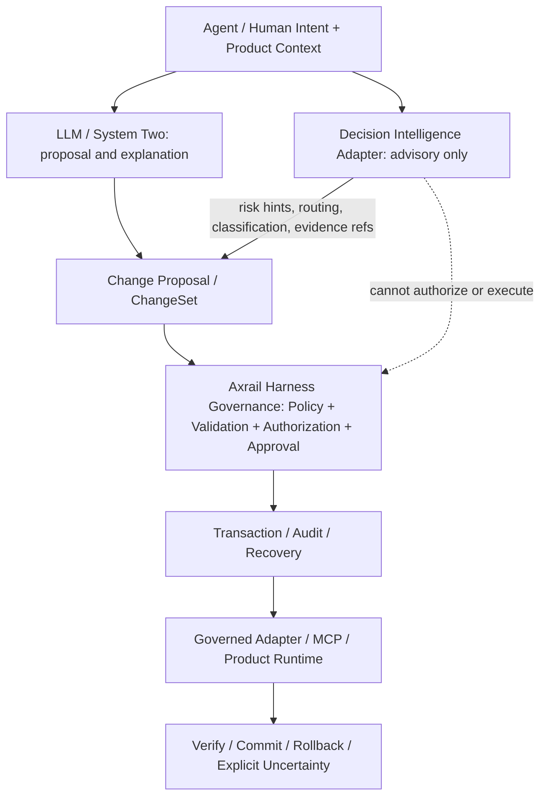

# RFC 0015：决策智能适配层与工业 Agent 评估体系

状态：**Proposed / Design only**（2026-11-15）。本 RFC 不包含运行时代码、生产激活或模型供应商采购授权。

## 1. 摘要和背景

Axrail 的主路径保持 `Agent/Human Intent → Change Proposal → ChangeSet → Transaction (Policy/Validation/Approval/Audit) → Adapter/MCP → Verify/Commit/Rollback/Explicit Uncertainty`，继续以 TypeScript `HarnessRuntime` 和 `AdapterHost` 为受支持的组合基线。决策模型（System One，如 TypeSafe AI Jev）仅提供**非授权性建议**，用于分类、路由、评分、异常筛查与证据补全，不成为新的执行内核或审批权威。大语言模型（System Two）负责复杂推理、工程解释与计划生成，确定性治理核心负责最终验证及执行准入。

此设计吸收 InfoQ 2026 AI/ML/Data Engineering Trends Report 中 Harness Engineering、Agent Evaluation、Agent Security/Governance、Context Engineering、MCP/A2A、Physical AI 和边缘推理方面的趋势。**趋势不是工程有效性的证明**；新增适配必须先通过独立基准、故障注入和真实领域集成测试。

本 RFC 与 [RFC 0009](../0009-transactional-mutation/README.md) 的事务链、[RFC 0013](../0013-ai-sdk-provider-convergence/README.md) 的模型供应商桥及 [RFC 0014](../0014-constrained-device-go-runtime/README.md) 的跨语言治理契约互补。不得改变其安全边界或扩展未经批准的设备控制范围。

## 2. 核心不可变约束

1. **不授予权限**：模型输出的 `low_risk`、`allow`、置信度或分类标签均不等于 Authorization/Approval；不允许缩小实际执行所需的 Policy/Validation/Approval 链。
2. **默认安全降级**：Provider 超时、不可用、类型错误、低置信度、概率未校准、输入缺证据时进入 deterministic fallback / 人工复核 / deny，不能直接执行。
3. **不新增副作用通道**：Decision Adapter 不直接调用设备、Shell、PLC、机器人运动或领域写 API；所有有效变更仍经原有 Transaction/Adapter。
4. **可信边界**：模型上下文是数据，不可信身份。actor/provider/target、scope、版本和能力签名由宿主可信绑定；不因模型文本提升权限。
5. **审计与隐私**：记录 provider/model/version、schema version、输入证据引用、决定、概率、延迟、policy version 与关联 ID；默认不把客户工程、密钥、生产变量原文传给托管模型。
6. **未确定性不消失**：模型判断不能把 `execution_uncertain` 转为成功、失败或可重试；物理动作不会因模型置信度具有通用 rollback。
7. **非实时控制**：该层不得进入 PLC 安全联锁、急停、闭环控制或硬实时控制回路。

## 3. 拟议逻辑架构



Decision Provider 是**辅助接口**，不位于不可绕过的确定性策略的替代位置；任何调用路由建议必须由可信 Capability Registry 再次校验。优先考虑 Harness 与 Agent/Context 侧的独立模块/插件，而非改写核心。

## 4. 候选接口（概念草案，非已发布 API）

```typescript
interface DecisionRequest {
  schemaVersion: string;
  taskKind: "classify" | "route" | "score" | "detect";
  inputEvidenceRefs: string[];
  allowedLabels?: string[];
  correlationId: string;
  deadlineMs: number;
}
interface DecisionResult {
  schemaVersion: string;
  providerId: string;
  modelId: string;
  decision: string;
  labelProbabilities?: Record<string, number>;
  confidenceSemantics?: string;
  evidenceRefs: string[];
  latencyMs: number;
  status: "ok" | "abstain" | "unavailable" | "invalid";
}
interface DecisionProvider {
  evaluate(request: DecisionRequest): Promise<DecisionResult>;
}
```

接口需要独立版本化、Schema 正反向兼容、deadline/cancellation、最大响应与上下文字节、明确单位和概率语义。不能假定不同模型的 score、confidence 和 calibrated probability 可互换。生产实现必须规定脱敏策略与数据保留/跨境调用限制。

建议候选后端为：
- `rule-based`：确定性 baseline、回退和回归对照；
- `typesafe-jev`：实验性商业托管 Provider，只接收批准的非敏感/脱敏数据；
- `local-decision`：后续可替换的本地小模型/开源模型，是否支持边缘部署以实测为准。

不把 Jev 认定为开源或本地可部署模型，不预设 Jev 的延迟/成本达到官方宣传值，不把模型的类型化输出等同于语义正确或安全证明。对 Go 设备端，仅通过 RFC 0014 的可移植只读 profile/受控 Context Port 接入，首期不复制完整 TypeScript Harness。

## 5. 三领域验证计划

### H — HMI/SCADA 组态

用脱敏、经批准的历史变更数据集验证：指令风险初筛、Selection Context/target 关联、工具路由和审查升级建议。示例“把温度报警阈值从 80°C 改至 95°C”应由模型建议高风险/需工程核查；真正可否更改由工程规则、设备上下限、ChangeSet 绑定、审批和目标版本决定。必须覆盖过期选区、越作用域、错误单位、修改审批摘要、假冒权限和模型误判。

### W — 焊接仿真平台

复用既有 Python/RoboDK/Worker/Job/Attempt 所有权；决策模型仅辅助工件需求分类、仿真任务路由、日志/异常初筛和证据完整性提示。碰撞、IK/FK、节拍、路径有效性与发布条件由独立几何/物理/业务验证及审批证明。不能用视觉/模型评分冒充碰撞或安全检验。

### E — 工业 ARM64 HMI / 边缘网关

优先只读告警归类、诊断和数据质量分类；测断网、模型离线、时间/epoch 失效、恶劣输入与宿主资源占用。Jev 托管 API 不意味着本地可运行；本地候选模型必须分别测内存、P95 延迟、精度和设备稳定性。边缘端不增加物理写入能力。

三个场景的集成目前均是计划，不得宣称已经实现或通过工业现场认证。

## 6. 评估 Harness 与基准要求

- **数据集**：HMI 高危/普通/只读及越权样本；焊接仿真任务/错误样本；边缘时序与质量异常。采用已脱敏的固定 fixtures，并维护 independent holdout、困难样本和对抗集。
- **对照**：确定性规则、现有 LLM、Jev、候选本地模型；相同输入、标签定义、环境、网络和业务验收机制。
- **分类指标**：每类 precision/recall、混淆矩阵、关键高危场景 false-negative、拒判率及人工审核率；高危漏判在固定验收集要求为 0，同时报告置信区间而非宣称绝对无风险。
- **概率指标**：ECE/Brier/reliability plots 与按领域重新校准；按先验与场景设拒判/升级阈值，不能使用未经验证的通用 0.9 阈值。
- **系统指标**：Schema 合法率、P50/P95/P99、单次成本、回退成功率、数据脱敏率、provider 断连/超时、Context 过期、变更哈希与审计完整性。
- **确定性安全测试**：模型错误输出/供应商不可用时，全部硬 Policy 和审批条件仍生效；任何模型不得审批或执行工具。验证模拟 Adapter 下的 side-effect checkpoint、uncertain、非盲重试。
- **设备测试**：遵守 RFC 0014 的宿主共存、资源、恢复及设备安全 gates，所有数值应标识为实测或目标。
- **退出判据**：回归集无权限绕过、无 Schema 越界、无模型导致的越权效果；模型相对规则基线的质量/延迟/成本收益须可重复且能追溯版本。未达标则保持禁用/实验性。

## 7. 分阶段 Roadmap 与 Gate

| 阶段 | 范围 | 出口条件 |
| --- | --- | --- |
| v0.2.x（设计/离线 PoC） | 契约、数据标签、风险矩阵、脱敏样本、规则 baseline、Jev 可行性测试 | 维护者评审通过；不改变 v0.2 已冻结执行路径 |
| v0.3（候选） | Decision Provider 插件、模型失效安全降级、证据/审计、HMI advisory slice | 有独立离线评估与 HMI 真实 Adapter 回归证据；实施 PR 分开批准 |
| v0.4（候选） | 焊接仿真/边缘只读 vertical evaluation、故障注入及跨实现 conformance | 三域证据可比，不能以仿真成功代替生产认证 |
| v0.5+（研究） | 本地小模型与边缘部署、分布式治理 | 实测设备资源、安全、维护成本及跨设备身份条件 |

**合并此 RFC 仅代表设计进入仓库讨论基线，不意味着实施 Gate、生产部署、供应商采购、硬件控制或 API 稳定性获批。** 每个阶段均需独立治理 Owner、任务、审批、CI 和真实验证结果。

## 8. 与现有提案的合并关系

- RFC 0009：不改变 ChangeSet/Transaction 权威，风险分类仅作为前置建议；
- RFC 0013：模型接入依旧 provider-agnostic，Jev 适配不绕过模型与工具分离；
- RFC 0014：可移植治理契约可携带规范化决策证据引用，不要求 Go SDK 复制新内核；
- HMI 优先、焊接仿真第二领域、受限设备只读第三领域；不把新研究变成 v0.2 阻塞项。
- 历史或外部文献的性能数据必须标为“供应商声称/研究结果”，不得作为 Axrail 实测 KPI。

## 9. 来源与需持续核实的假设

- [InfoQ: AI, ML and Data Engineering Trends Report – 2026](https://www.infoq.com/articles/ai-ml-data-engineering-trends-2026/)
- [TypeSafe AI: Introducing System One Models & Jev](https://typesafe.ai/blog/introducing-system-one-models-and-jev)
- [TypeSafe AI Documentation](https://docs.typesafe.ai/introduction)
- [新加坡 GovTech AI：Decision Models for Guardrails: Jev and Kev](https://blog.ai.gov.sg/decision-models-for-guardrails-exploring-jev-and-kev-for-moderation/)

上述资料作为技术候选的出发点，不构成供应商安全认证或本项目的 benchmark。实施前须再次确认授权、价格、API/区域与隐私政策。
